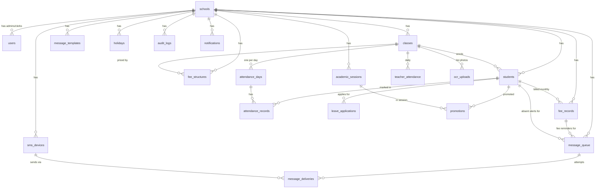

# ER Overview — School Management Platform

Source of truth: `contracts/SCHEMA.md` and `backend/prisma/schema.prisma`.
All tables are PostgreSQL. Every tenant-scoped table carries `school_id`
(UUID, FK → `schools`, `ON DELETE CASCADE`) and is always queried scoped
to one school (tenant middleware + `school_id` in every `where`).

## Diagram (Mermaid — renders on GitHub / in most Markdown viewers)

## Entity groups

| Group | Tables | Key rules |
|---|---|---|
| Tenancy & access | `schools`, `users` | One school = one tenant. `users.role` is `admin` (everything) or `clerk` (fees + read-only logs; cannot manage users, settings, links, or approve messages). |
| People | `classes`, `students` | Class = name + section, unique per school. Student roll number unique per class. Parent phone stored encrypted (`parent_phone_enc`) + SHA-256 hash (`parent_phone_hash`) for duplicate detection only. `parent_opt_out = true` means never message that number. |
| Attendance | `attendance_days`, `attendance_records`, `teacher_attendance`, `leave_applications` | One `attendance_day` per class per day (unique). Records are `present / absent / late / leave`. Teacher absence is recorded only — it never creates messages. |
| Fees | `fee_structures`, `fee_records` | One active fee structure per class (latest `effective_from`). One `fee_record` per student per month (`YYYY-MM`, unique). `status` is a GENERATED column (`unpaid / partial / paid`) computed from amounts — never written by code. Receipt numbers are `{school_slug}-{YYYYMM}-{seq}`, sequential per school. |
| Messaging | `message_templates`, `message_queue`, `message_deliveries`, `sms_devices` | `message_queue` is the outbox and the ONLY source of sends. `dedupe_key` is UNIQUE: `absent:{student_id}:{date}`, `fee:{student_id}:{month}`, `teacher:{class_id}:{date}` — the database itself prevents double sends. Templates exist per type × language (`absent / fee_reminder / teacher_reminder` × `en / ur`) with `{variables}`. `sms_devices` are the Android companion phones; online = `last_seen_at` within 90 s. |
| School calendar | `holidays`, `academic_sessions`, `promotions` | Sundays are always non-school days (no row needed). No attendance or messages on Sundays/holidays. Promotions move students between classes within a session. |
| Audit & ops | `ocr_uploads`, `audit_logs`, `notifications` | Every mutation writes an `audit_logs` row (actor, action, entity, details). `ocr_uploads` tracks list-photo imports (`processing → review → saved / failed`). `notifications` feed the in-portal notification centre. |

## Invariants the code must never break

1. **No message without approval** — absent/fee drafts sit in `message_queue`
   unapproved until an admin approves; the Android app and gateway only ever
   read `approved + queued` rows.
2. **Absent-only** — only students with status `absent` get drafts; present /
   late / leave students never do; teacher absence never does.
3. **One send per (student, day/month)** — enforced by the unique
   `dedupe_key`, not just by application logic.
4. **Paid means silent** — a `paid` fee record never generates a reminder,
   and month rollover never re-creates a record for an already-paid month.
5. **Phones are secrets** — encrypted at rest (AES-256-GCM, `PHONE_ENC_KEY`),
   masked in every response and log, decrypted only at send time or for an
   authorized admin view.
6. **School-local dates** — "today", month rollovers and job schedules are
   always computed in the school's timezone, never server-local time.
